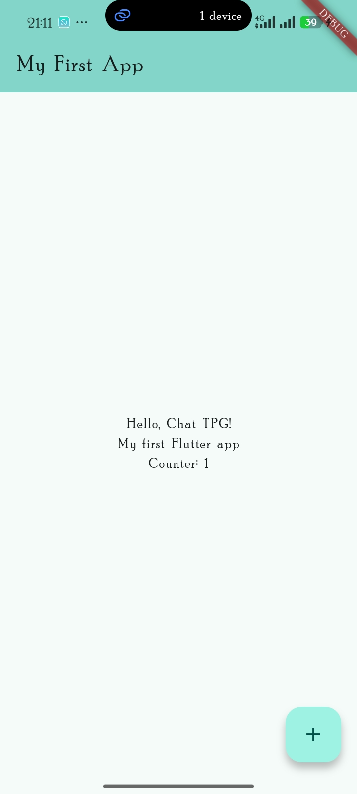
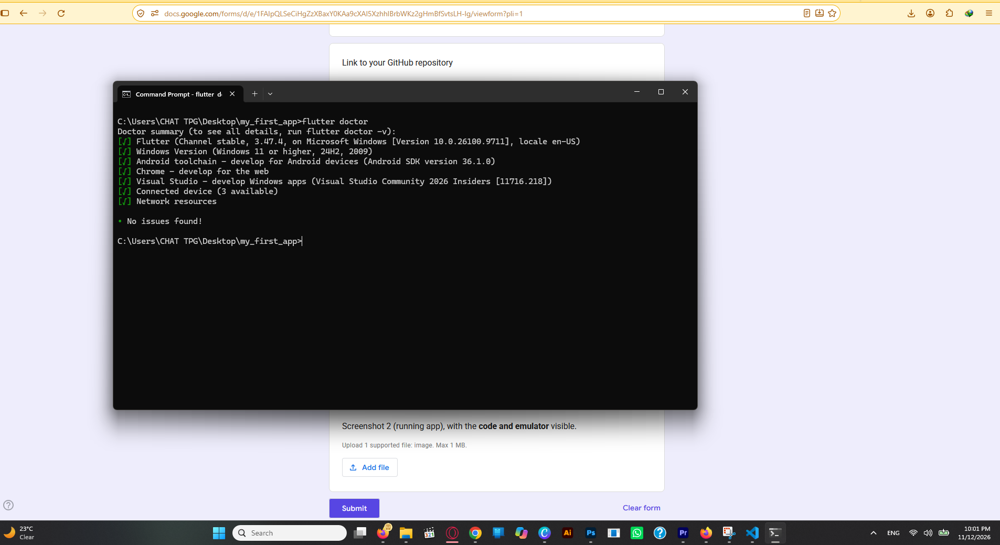

# my_first_app

Lab 1: my first Flutter app, running on [my Android phone / an Android emulator].

## Screenshots

## What I did
- Installed Git, Flutter, VS Code and Android Studio, and got `flutter doctor` working
- Ran the app on my Phone 
- Changed the greeting to "Hello, Chat TPG!", the theme seed colour to teal, and the app title
- Added a second `Text` in a `Column`
- Logged the screen width: [your value] dp (classmate's phone: [value] dp)

## What I learned and what blocked me

In this lab I learned that Flutter lets me build and change an app very quickly.
With hot reload (r), I could edit the text, the theme colour or the layout and
see the result on my phone almost immediately, which made it easy to experiment
and improvise. I also learned how widgets like Column and Text fit together,
that screen sizes are measured in dp, and how to use Git and GitHub to save and
share my work with clear commits.

What blocked me was mostly the setup. Installing Flutter and Android Studio
took a while, and flutter doctor first showed a warning because the Android
licenses were not accepted, which I fixed with flutter doctor --android-licenses.
Then Git gave me an error when I added the remote, because I typed the angle
brackets from the example URL, and I also had moments where Git said there was
nothing to commit because my changes were already saved in an earlier commit.
Fixing these problems taught me to read error messages carefully and to check
git status before committing.